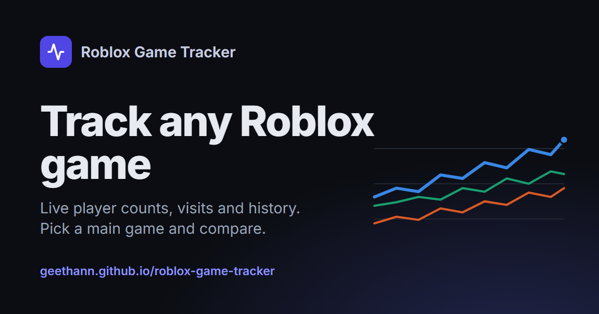
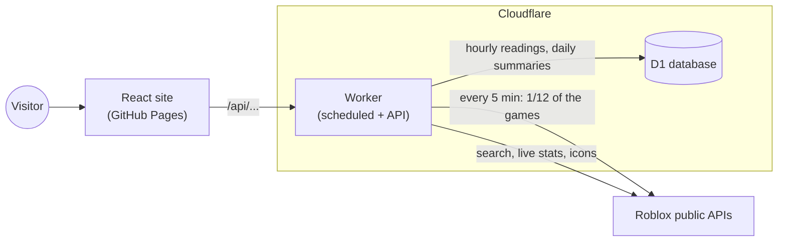

# Roblox Game Tracker

[](https://github.com/Geethann/roblox-game-tracker/actions/workflows/website.yml)
[](https://github.com/Geethann/roblox-game-tracker/actions/workflows/backend.yml)

Live player counts, visits and history for any Roblox game. Pick a main game and compare it with others.

**[Open the live site →](https://geethann.github.io/roblox-game-tracker/)**



## Features

- **Search any Roblox game**, with suggestions as you type and keyboard shortcuts (`/`, ↑ ↓, Enter, Esc).
- **Game pages:** live player count (refreshes every minute), rank, stat cards showing change over the chosen range, and a history chart with update markers, a table view and CSV export.
- **Ranges:** 24h, 7d, 30d, 90d, 1Y, YTD and All. Short ranges show hourly readings; long ranges use daily summaries.
- **Charts:** Most played, Trending on Roblox, Rising, Most visits today, Top rated and Recently updated, each with a full sortable, filterable table.
- **Compare:** your main game against up to four others on one chart, with a "% change" view so games of very different sizes can be compared fairly.
- Light and dark mode, works on phones, and every view lives in the URL so it can be shared.

## How it works



- **Collection.** A Cloudflare Worker runs every 5 minutes. Games are split into 12 groups by ID, and each run collects one group, so every game is read once an hour while each run stays small enough for the free plan.
- **Discovery.** Every hour the Worker adds the games on Roblox's front-page lists. Opening any game on the site adds it too. Up to 1,500 games are tracked; games with no players for 30 days are paused (their history is kept).
- **Storage.** Hourly readings are kept for 90 days. A nightly job summarises each day (average, peak and end-of-day totals) into a table kept forever, so long ranges load quickly.
- **Precomputed lists.** The charts and home page lists are worked out once an hour and stored, so serving them costs one tiny database read per visitor.
- **API.** The same Worker serves a JSON API for the site (search, game details, history, charts), with caching and CORS. Roblox's API can't be called from a browser directly, so the Worker acts as the proxy.

## Design decisions

- **Honest numbers.** Players are checked hourly, so the site says "Peak (hourly)" and explains what that means. Unfinished days are left out of daily gains instead of showing a fake drop. Rating charts never zoom in so far that a tiny wobble looks dramatic. The [How it works](https://geethann.github.io/roblox-game-tracker/about) page lists the data's limits.
- **Free-plan budget.** About 48 database writes per game per day (24 saved, 24 old ones deleted) keeps 1,500 games under D1's 100,000 writes a day. Queries look rows up by primary key instead of scanning tables, to stay inside the read allowance.
- **Charts that read correctly.** One measure per chart (never two scales on one chart), colourblind-safe colours checked against both themes, a legend and a table view for every comparison, and each game keeps its colour when others are removed.
- **Accessible by default.** Keyboard navigation, screen-reader labels (search combobox, `aria-sort` on tables, chart table views), reduced motion support, and visible focus outlines.
- **`main` is what's live.** Every change goes through a pull request: code checks, tests and a build must pass before merging, and merging deploys automatically.

## Tech stack

| Part | Built with |
|---|---|
| Website | React 19, Vite, React Router, TanStack Query, Recharts |
| Backend | Cloudflare Workers (JavaScript), Cloudflare D1 (SQLite) |
| Quality | ESLint, Vitest (unit tests for all the data logic) |
| Deployment | GitHub Actions → Cloudflare and GitHub Pages |

## Project structure

```
site/                    React website
  src/lib/               data logic (formatting, chart maths, sorting) + its tests
  src/components/        shared pieces (search, charts, icons...)
  src/pages/             one file per page
worker/                  Cloudflare Worker
  src/collect.js         hourly readings
  src/discover.js        finding new games
  src/maintenance.js     nightly summaries, hourly charts
  src/api.js             the public API
  migrations/            database changes, in order
.github/workflows/       checks on pull requests, deploys from main
```

## Running it locally

Needs Node 22.

```bash
# Website (uses the live API by default)
cd site
npm ci
npm run dev        # http://localhost:5173/roblox-game-tracker/
npm test           # unit tests
npm run lint       # code checks

# Backend, with a local test database
cd worker
npm ci
npm run db:migrate:local
npm run dev
```

To point the website at a local backend, start it with `VITE_API_URL=http://127.0.0.1:8787`.

## Deployment

Merging into `main` deploys automatically:

- **Backend:** applies any new database migrations, then deploys the Worker. Needs the `CLOUDFLARE_API_TOKEN` and `CLOUDFLARE_ACCOUNT_ID` repository secrets.
- **Website:** checks the code, runs the tests, builds and publishes to GitHub Pages.
- **Optional:** set a `CF_ANALYTICS_TOKEN` repository variable to turn on Cloudflare Web Analytics (cookie-free visitor counts).

---

Unofficial fan project, not affiliated with or endorsed by Roblox Corporation.
