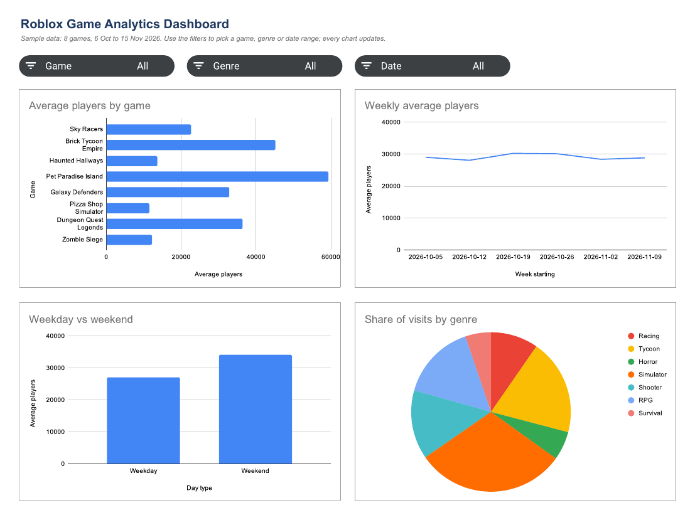
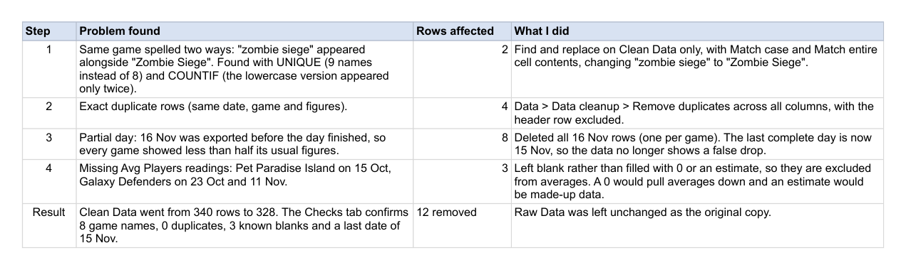
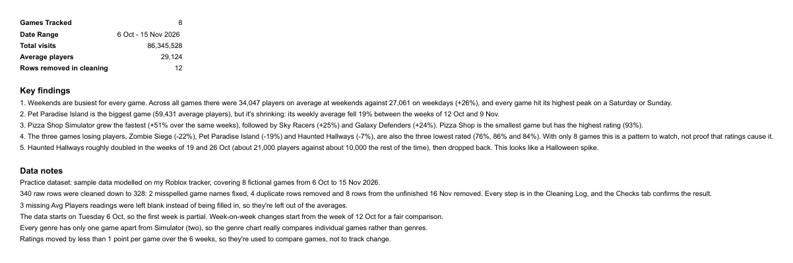

# Roblox Game Analytics: Data Cleaning & Dashboard

> **Practice dataset.** This analysis uses 340 rows of sample data modelled on my [Roblox Game Tracker](../README.md), covering 8 fictional games from 6 Oct to 15 Nov 2026. The data has deliberate problems in it (duplicates, inconsistent names, missing values, an unfinished day) so I could practise cleaning it properly. In December I'll swap in four weeks of real data exported from the tracker's database.

**[Open the Google Sheet (view only) →](https://docs.google.com/spreadsheets/d/141rvf67SOd8ChgzVDrT57xRJcAyLl1J73K_7RK6rd78/edit?usp=sharing)**

## The question

What drives player numbers across a group of Roblox games? Specifically: which games are growing or shrinking, how much busier weekends are, and whether anything else (like ratings or seasonal events) lines up with the changes.

## The data

One row per game per day:

| Column | What it means |
|---|---|
| Date | The day (UTC) |
| Game | The game's name |
| Avg Players | Average players online across the day |
| Peak Players | Most players online at any reading that day |
| Daily Visits | New visits that day |
| New Favourites | New favourites that day |
| Rating % | Likes as a % of likes + dislikes |

I added helper columns with formulas: day of the week, weekday or weekend, the Monday each week starts on, peak divided by average, and each game's genre (looked up from a Game Info tab with `XLOOKUP`).

## Cleaning

I kept Raw Data untouched and did all the cleaning on a copy, logging every step in a Cleaning Log tab. A Checks tab uses formulas to prove the cleaning worked (row counts, date range, number of game names, duplicates, blanks, failed lookups).

| Step | Problem | Rows | What I did |
|---|---|---|---|
| 1 | "zombie siege" and "Zombie Siege" were counted as two games. I spotted it because `UNIQUE` gave 9 names instead of 8. | 2 | Find and replace on the clean copy only, matching case and whole cell. |
| 2 | Exact duplicate rows. | 4 | Removed duplicates across all columns. |
| 3 | 16 Nov was exported before the day finished, so every game showed less than half its usual numbers. | 8 | Removed 16 Nov, so the charts don't show a fake drop. |
| 4 | Missing Avg Players readings. | 3 | Left blank rather than filled with 0 or a guess. A 0 would drag the averages down and a guess would be made-up data. |

**Result:** 340 rows → 328, with 8 game names, 0 duplicates and 3 known blanks.

## Findings

1. **Weekends are busiest for every game.** Across all games there were 34,047 players on average at weekends against 27,061 on weekdays (+26%), and every game hit its highest peak on a Saturday or Sunday.
2. **The biggest game is shrinking.** Pet Paradise Island has the most players (59,431 average), but its weekly average fell 19% between the weeks of 12 Oct and 9 Nov.
3. **The smallest game is growing fastest.** Pizza Shop Simulator grew 51% over the same weeks, followed by Sky Racers (+25%) and Galaxy Defenders (+24%). Pizza Shop also has the highest rating (93%).
4. **The shrinking games are the lowest rated.** Zombie Siege (-22%), Pet Paradise Island (-19%) and Haunted Hallways (-7%) are also the three lowest rated (76%, 86% and 84%). With only 8 games this is a pattern to watch, not proof that ratings cause it.
5. **Seasonal spike.** Haunted Hallways roughly doubled in the weeks of 19 and 26 Oct (about 21,000 players against about 10,000 the rest of the time), then dropped back, which looks like a Halloween spike.

## Limitations

- It's sample data, so the findings show the method, not real Roblox trends.
- The data starts on a Tuesday, so the first week is partial. Week-on-week changes start from the week of 12 Oct.
- Every genre has only one game apart from Simulator, so the genre chart really compares games rather than genres.
- Ratings barely moved (under 1 point per game), so they're used to compare games, not to track change.

## How it's built

Google Sheets only:

- **Cleaning:** `UNIQUE`, `COUNTIF`, Find and replace, Remove duplicates
- **Helper columns:** `TEXT`, `WEEKDAY`, `XLOOKUP`
- **Checks:** `COUNTIFS`, `COUNTA`, `UNIQUE` + `FILTER`
- **Analysis:** pivot tables (averages, peaks, weekday vs weekend, week by week)
- **Dashboard:** 4 charts built from the clean data, with slicers for game, genre and date that filter every chart at once

## Next steps

- **December:** replace the sample data with four weeks of real daily data for the 10 most-played games, exported from the tracker's database with one SQL query, then redo the cleaning and findings.
- **After that:** do the same analysis in SQL and Tableau.
